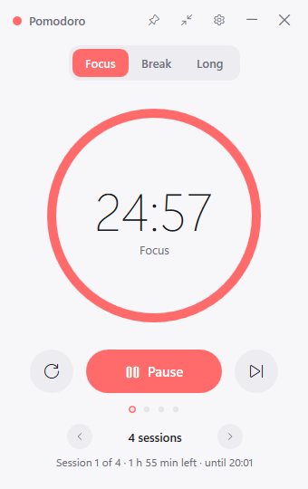
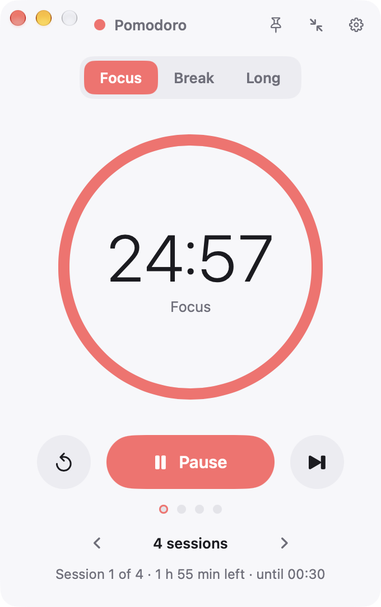
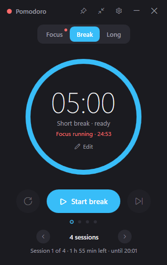
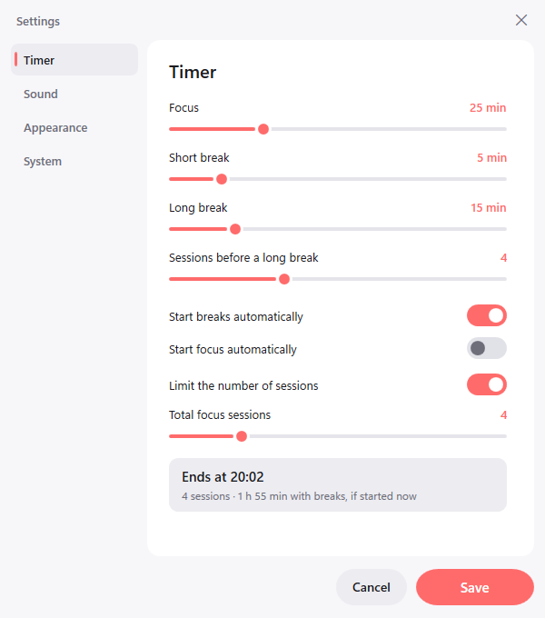
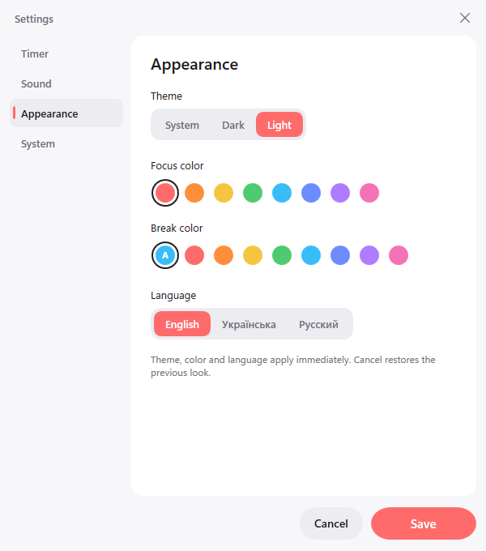
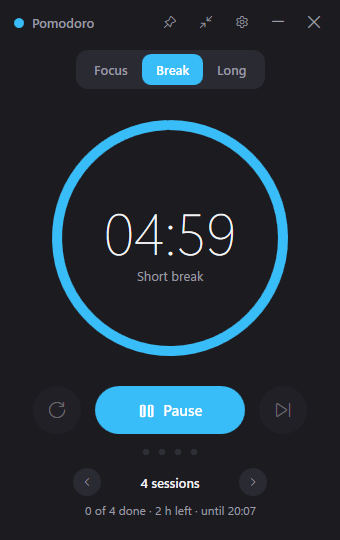
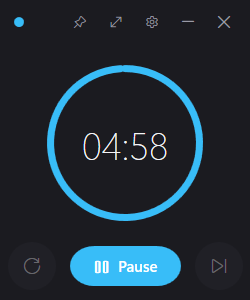
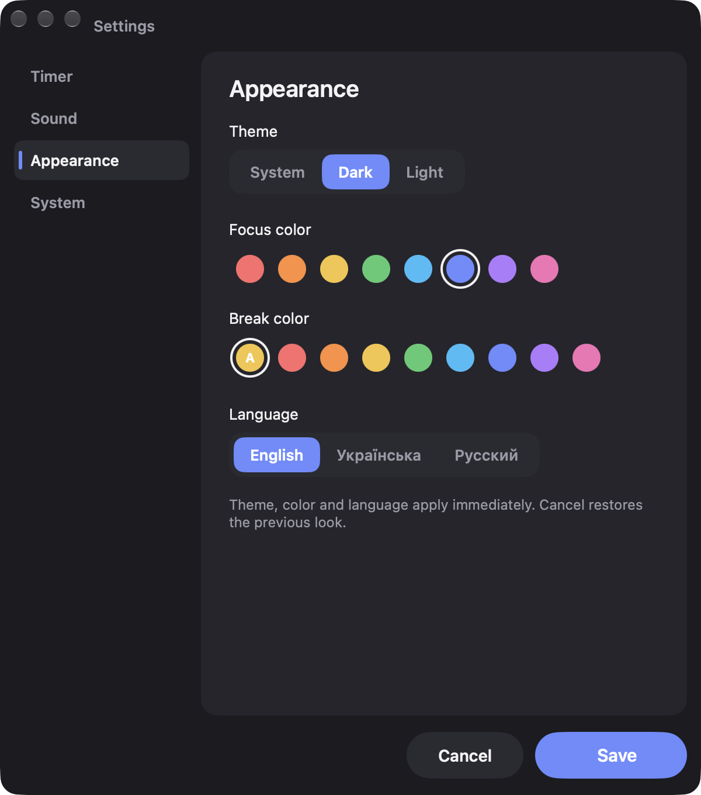

# Pomodoro

A small, native Pomodoro timer for Windows and macOS. No Electron, no browser inside.
Windows: C# / WPF on .NET 8, a single executable of a couple of megabytes that uses about 40 MB of
memory. macOS: Swift, AppKit + SwiftUI, the same timer, settings file and look (see [macOS](#macos)).

**Website:** https://shimodos.github.io/pomodoro-site/ · [Русская версия](README.ru.md)

<p align="center">
  
  &nbsp;&nbsp;
  
  &nbsp;&nbsp;
  
</p>
<p align="center"><sub>Windows · macOS · Windows (dark)</sub></p>

**Available for Windows 10 / 11 and macOS 13+.** Both versions are in this repository and ship from the same release.

## Download

Grab the latest build from the [Releases](https://github.com/Shimodos/PomodoroTimer/releases) page:

| File | What it is |
|---|---|
| `Pomodoro-<version>-win-x64.zip` | **Recommended.** Self-contained: unzip anywhere and run `Pomodoro.exe`. Nothing else to install. |
| `Pomodoro-<version>-win-x64-framework.zip` | Small build that needs the [.NET 8 Desktop Runtime](https://dotnet.microsoft.com/download/dotnet/8.0). |

Windows 10 / 11, x64. No installer: the app keeps its settings in `%AppData%\PomodoroTimer`, so you can delete the folder to uninstall.

| File | What it is |
|---|---|
| `Pomodoro-<version>-macos.dmg` | **macOS.** Open, drag Pomodoro to Applications. |
| `Pomodoro-<version>-macos.zip` | The same `.app` zipped. |

macOS 13 Ventura or newer, Apple Silicon and Intel. The build is signed ad hoc and not notarized
(no Apple Developer account), so the first launch shows “Apple could not verify Pomodoro.app”. Click
**Done**, then open **System Settings → Privacy & Security**, scroll to *Security* and press
**Open Anyway** next to Pomodoro; once is enough. Or run
`xattr -d com.apple.quarantine /Applications/Pomodoro.app` in Terminal.

## Features

- **Focus / short break / long break** with adjustable durations and a configurable number of sessions before a long break.
- **Session limit right on the main screen.** Pick `‹ 4 sessions ›` (or ∞), and the app shows how much time is left and when the last session ends.
- **Tabs that only look.** Switching to another tab shows that phase without touching the running countdown. The live tab keeps a dot and a "Focus running · 23:41" line that jumps back to it. Only the "Start break" button actually switches phases.
- **Edit durations in place.** Press "Edit" under the time, type the minutes or step by ±5, hit Enter.
- **Two accent colors.** One for focus, one for breaks, so you can tell which timer is running at a glance. The break color defaults to a matching companion of the focus color and can be picked separately.
- **Sounds.** Eight built-in alerts (synthesized, license-free), any WAV or MP3 of your own, volume control, preview.
- **Notifications and tray.** Windows notification when a phase ends, tray icon showing the minutes left, minimize and close to tray.
- **Pop up when a phase ends.** The window comes back on top of everything (even from the tray) so you never miss the end of a focus or a break. Can be switched off.
- **Compact mode** and **always on top** for keeping the timer in a corner.
- **Dark, light or system theme.**
- **Three languages:** English, Ukrainian, Russian. Picked up from Windows on first run, switchable live in settings.
- **Start with Windows.**

<p align="center">
  
  &nbsp;&nbsp;
  
</p>
<p align="center">
  
  &nbsp;&nbsp;
  
</p>

## Build from source

Requires the .NET 8 SDK and nothing else (no Visual Studio needed).

```bash
dotnet build -c Release
```

Run from source:

```bash
dotnet run
```

Single-file build that needs the .NET 8 Desktop Runtime:

```bash
dotnet publish -c Release -r win-x64 --self-contained false -p:PublishSingleFile=true -o bin/publish
```

Fully self-contained build (about 70 MB, no runtime needed):

```bash
dotnet publish -c Release -r win-x64 --self-contained true -p:PublishSingleFile=true -p:IncludeNativeLibrariesForSelfExtract=true -o bin/publish-standalone
```

Releases are built by [GitHub Actions](.github/workflows/release.yml) when a `v*` tag is pushed.

## macOS

The native Mac version lives in [`macos/`](macos/) and shares the sounds, the icon and the string
tables with the Windows app. Same timer logic, same two windows, same `settings.json`: a file from
Windows works on the Mac and vice versa. What is deliberately different: native window chrome with the
traffic lights, a menu bar item instead of the tray icon, macOS notifications, "Open at login" as a
login item, SF Symbols and the system font. Details, screenshots and the full spec:
[`docs/macos/`](docs/macos/).

<p align="center">
  
  &nbsp;&nbsp;
  
</p>

Build on a Mac with the Command Line Tools (`xcode-select --install`) or Xcode; nothing else:

```bash
cd macos && make app
```

```bash
cd macos && make test
```

`make run` builds and opens `macos/build/Pomodoro.app`, `make zip` and `make dmg` produce the
release files. Settings and logs live in `~/Library/Application Support/PomodoroTimer/`
(`POMODORO_DATA_DIR` overrides). Releases for both platforms are built by GitHub Actions
([Windows](.github/workflows/release.yml), [macOS](.github/workflows/release-macos.yml)) when a
`v*` tag is pushed.

## Project layout

| Folder | Contents |
|---|---|
| `Models/` | `AppSettings`, everything the user can configure |
| `Services/` | timer engine, sounds, tray, themes, localization, autostart, settings storage, activity log |
| `ViewModels/` | state of the main window and the settings dialog |
| `Views/` | XAML of both windows |
| `Themes/` | `Dark.xaml`, `Light.xaml` (colors), `Styles.xaml` (control styles) |
| `Localization/` | `Strings.en.xaml` (key reference), `Strings.uk.xaml`, `Strings.ru.xaml` |
| `Controls/` | `ProgressRing` |
| `Sounds/` | built-in WAV alerts |
| `Assets/` | application icon |
| `tools/` | `gen-assets.js`, the Node script that synthesizes the sounds and draws the icon |
| `macos/` | the macOS app: Swift package (`PomodoroCore` logic + `PomodoroApp` UI), tests, build scripts |
| `docs/macos/` | spec, architecture and screenshots of the macOS port |

No third-party packages: the Fluent-like look is hand-written WPF styles, the tray uses the WinForms `NotifyIcon`, audio goes through WPF `MediaPlayer`.

## Files on disk

| File | Purpose |
|---|---|
| `%AppData%\PomodoroTimer\settings.json` | settings |
| `%AppData%\PomodoroTimer\activity.log` | journal of timer events (start, pause, skip, completion and what triggered them) |
| `%AppData%\PomodoroTimer\error.log` | unhandled exceptions |

Set the `POMODORO_DATA_DIR` environment variable to move all three somewhere else (portable use).

## Adding a sound or a language

- **Sound:** drop a WAV into `Sounds/` and add a `Sound_<name>` string to each file in `Localization/`.
- **Language:** copy `Localization/Strings.en.xaml`, translate the values, add the code to `Localizer.Supported` and a radio button in `Views/SettingsWindow.xaml`.

## License

MIT
