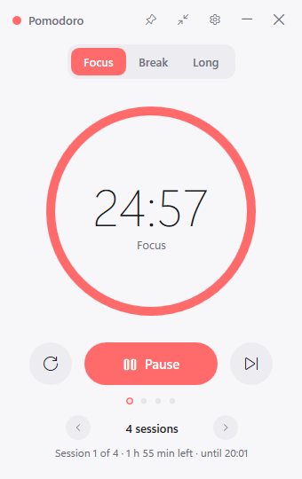
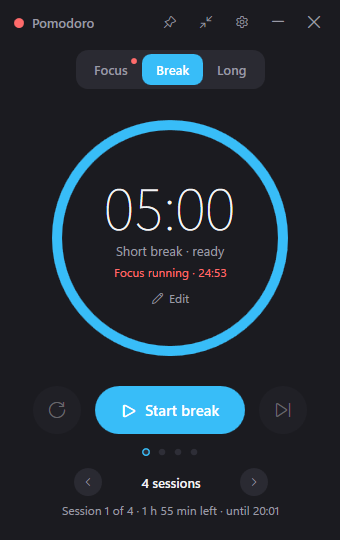
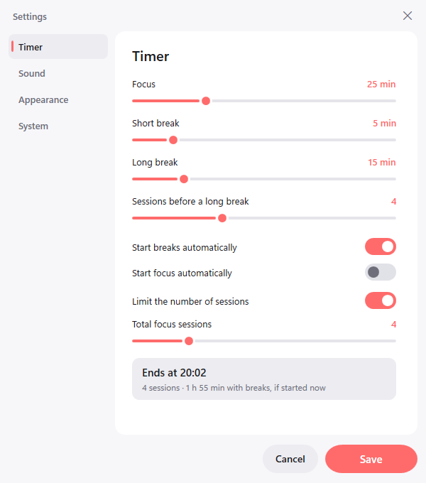
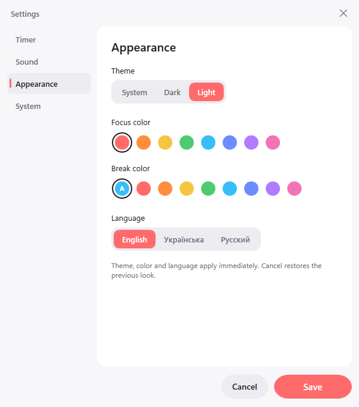
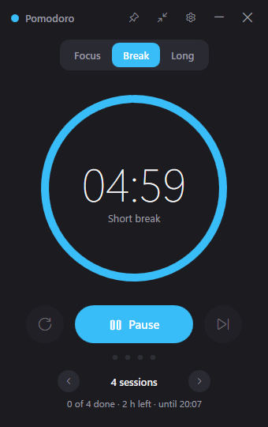
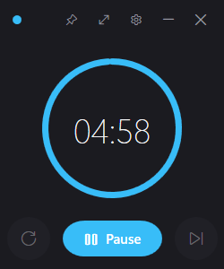

# Pomodoro

Нативный таймер Pomodoro для Windows на C# / WPF (.NET 8). Без Electron, без браузера внутри:
один exe размером в пару мегабайт и около 40 МБ памяти.

[English version](README.md)

<p align="center">
  
  &nbsp;&nbsp;
  
</p>

## Скачать

Готовые сборки лежат на странице [Releases](https://github.com/Shimodos/PomodoroTimer/releases):

| Файл | Что это |
|---|---|
| `Pomodoro-<версия>-win-x64.zip` | **Рекомендуется.** Автономная сборка: распаковать и запустить `Pomodoro.exe`, ничего ставить не нужно. |
| `Pomodoro-<версия>-win-x64-framework.zip` | Маленькая сборка, нужен [.NET 8 Desktop Runtime](https://dotnet.microsoft.com/download/dotnet/8.0). |

Windows 10 / 11, x64. Установщика нет: настройки хранятся в `%AppData%\PomodoroTimer`, для удаления достаточно стереть папку.

## Возможности

- **Фокус / короткий перерыв / длинный перерыв** с настраиваемой длительностью и числом сессий до длинного перерыва.
- **Число сессий прямо на главном экране.** Переключатель `‹ 4 сессии ›` (или ∞), под ним сколько осталось и во сколько закончится последняя сессия.
- **Вкладки только показывают фазу.** Переход на другую вкладку не трогает идущий отсчёт: на его вкладке горит точка, строка «Фокус идёт · 23:41» возвращает к нему. Фазу переключает только кнопка «Начать …».
- **Длительность меняется на месте.** «Изменить» под временем, ввод минут или шаг ±5, Enter.
- **Два акцентных цвета.** Свой для фокуса и свой для отдыха, чтобы сразу видеть, какой таймер идёт. Цвет отдыха по умолчанию подбирается парой к цвету фокуса, но его можно выбрать отдельно.
- **Звуки.** Восемь встроенных сигналов (синтезированы скриптом, свободны от лицензий), любой свой WAV или MP3, громкость, предпрослушивание.
- **Уведомления и трей.** Уведомление Windows по окончании фазы, иконка в трее с оставшимися минутами, сворачивание и закрытие в трей.
- **Компактный режим** и **поверх всех окон**.
- **Тёмная, светлая или системная тема.**
- **Три языка:** английский, украинский, русский. Берётся из Windows при первом запуске, меняется в настройках без перезапуска.
- **Запуск вместе с Windows.**

<p align="center">
  
  &nbsp;&nbsp;
  
</p>
<p align="center">
  
  &nbsp;&nbsp;
  
</p>

## Сборка

Нужен только .NET 8 SDK, Visual Studio не требуется.

```bash
dotnet build -c Release
```

Запуск из исходников:

```bash
dotnet run
```

Один exe, которому нужен .NET 8 Desktop Runtime:

```bash
dotnet publish -c Release -r win-x64 --self-contained false -p:PublishSingleFile=true -o bin/publish
```

Полностью автономный exe (около 70 МБ):

```bash
dotnet publish -c Release -r win-x64 --self-contained true -p:PublishSingleFile=true -p:IncludeNativeLibrariesForSelfExtract=true -o bin/publish-standalone
```

Релизы собирает [GitHub Actions](.github/workflows/release.yml) при пуше тега `v*`.

## Структура

| Папка | Что внутри |
|---|---|
| `Models/` | `AppSettings` — все настройки |
| `Services/` | движок таймера, звук, трей, темы, локализация, автозапуск, хранение настроек, журнал событий |
| `ViewModels/` | состояние главного окна и окна настроек |
| `Views/` | XAML обоих окон |
| `Themes/` | `Dark.xaml`, `Light.xaml` — цвета; `Styles.xaml` — стили контролов |
| `Localization/` | `Strings.en.xaml` (эталон ключей), `Strings.uk.xaml`, `Strings.ru.xaml` |
| `Controls/` | `ProgressRing` |
| `Sounds/` | встроенные WAV-сигналы |
| `Assets/` | иконка приложения |
| `tools/` | `gen-assets.js` — скрипт на Node, который синтезирует звуки и рисует иконку |

Сторонних пакетов нет: вид в духе Fluent сделан стилями WPF, трей через `NotifyIcon` из WinForms, звук через `MediaPlayer` WPF.

## Файлы на диске

| Файл | Назначение |
|---|---|
| `%AppData%\PomodoroTimer\settings.json` | настройки |
| `%AppData%\PomodoroTimer\activity.log` | журнал событий таймера (старт, пауза, пропуск, завершение и что их вызвало) |
| `%AppData%\PomodoroTimer\error.log` | необработанные ошибки |

Переменная окружения `POMODORO_DATA_DIR` переносит все три файла в другую папку (портативный режим).

## Добавить звук или язык

- **Звук:** положить WAV в `Sounds/` и добавить строку `Sound_<имя>` в каждый файл в `Localization/`.
- **Язык:** скопировать `Localization/Strings.en.xaml`, перевести значения, добавить код в `Localizer.Supported` и кнопку в `Views/SettingsWindow.xaml`.

## Лицензия

MIT
