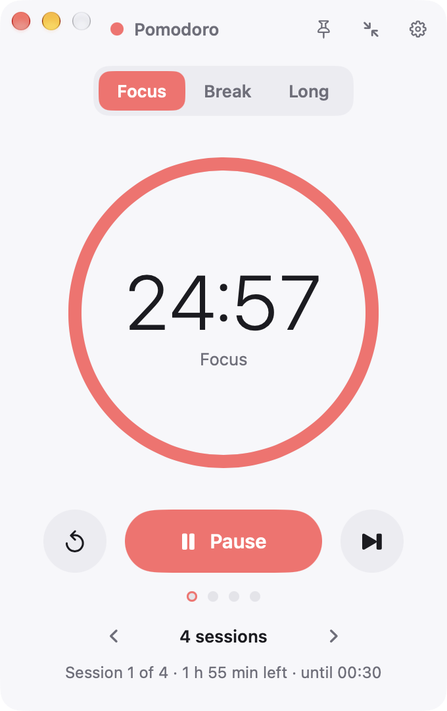
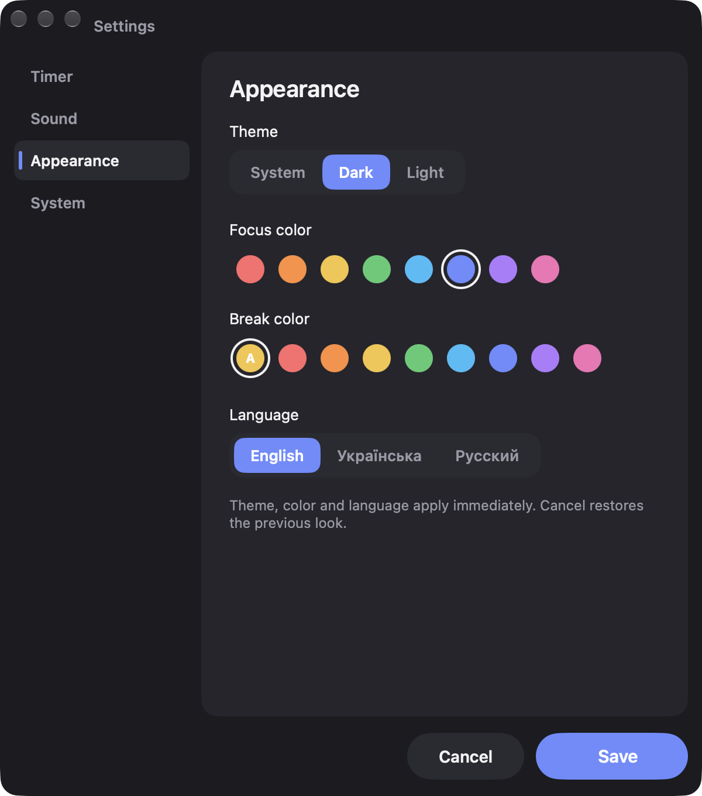

# Pomodoro

Нативный таймер Pomodoro для Windows и macOS. Без Electron, без браузера внутри.
Windows: C# / WPF (.NET 8), один exe размером в пару мегабайт и около 40 МБ памяти.
macOS: Swift, AppKit + SwiftUI, тот же таймер, те же настройки и вид (см. [macOS](#macos)).

**Сайт:** https://shimodos.github.io/pomodoro-site/ · [English version](README.md)

<p align="center">
  
  &nbsp;&nbsp;
  
  &nbsp;&nbsp;
  
</p>
<p align="center"><sub>Windows · macOS · Windows (тёмная)</sub></p>

**Есть для Windows 10 / 11 и macOS 13+.** Обе версии живут в этом репозитории и выходят одним релизом.

## Скачать

Готовые сборки лежат на странице [Releases](https://github.com/Shimodos/PomodoroTimer/releases):

| Файл | Что это |
|---|---|
| `Pomodoro-<версия>-win-x64.zip` | **Рекомендуется.** Автономная сборка: распаковать и запустить `Pomodoro.exe`, ничего ставить не нужно. |
| `Pomodoro-<версия>-win-x64-framework.zip` | Маленькая сборка, нужен [.NET 8 Desktop Runtime](https://dotnet.microsoft.com/download/dotnet/8.0). |

Windows 10 / 11, x64. Установщика нет: настройки хранятся в `%AppData%\PomodoroTimer`, для удаления достаточно стереть папку.

| Файл | Что это |
|---|---|
| `Pomodoro-<версия>-macos.dmg` | **macOS.** Открыть и перетащить Pomodoro в Applications. |
| `Pomodoro-<версия>-macos.zip` | Тот же `.app` в архиве. |

macOS 13 Ventura и новее, Apple Silicon и Intel. Сборка подписана ad hoc и не нотаризована (нет
аккаунта Apple Developer), поэтому при первом запуске macOS скажет «Не удалось проверить Pomodoro.app».
Нажми **Готово**, открой **Системные настройки → Конфиденциальность и безопасность**, прокрути до
раздела «Безопасность» и нажми **Открыть всё равно** рядом с Pomodoro; достаточно одного раза. Либо
выполни в Терминале `xattr -d com.apple.quarantine /Applications/Pomodoro.app`.

## Возможности

- **Фокус / короткий перерыв / длинный перерыв** с настраиваемой длительностью и числом сессий до длинного перерыва.
- **Число сессий прямо на главном экране.** Переключатель `‹ 4 сессии ›` (или ∞), под ним сколько осталось и во сколько закончится последняя сессия.
- **Вкладки только показывают фазу.** Переход на другую вкладку не трогает идущий отсчёт: на его вкладке горит точка, строка «Фокус идёт · 23:41» возвращает к нему. Фазу переключает только кнопка «Начать …».
- **Длительность меняется на месте.** «Изменить» под временем, ввод минут или шаг ±5, Enter.
- **Два акцентных цвета.** Свой для фокуса и свой для отдыха, чтобы сразу видеть, какой таймер идёт. Цвет отдыха по умолчанию подбирается парой к цвету фокуса, но его можно выбрать отдельно.
- **Звуки.** Восемь встроенных сигналов (синтезированы скриптом, свободны от лицензий), любой свой WAV или MP3, громкость, предпрослушивание.
- **Уведомления и трей.** Уведомление Windows по окончании фазы, иконка в трее с оставшимися минутами, сворачивание и закрытие в трей.
- **Окно всплывает по окончании этапа.** Таймер показывается поверх всех окон (даже из трея), чтобы конец фокуса или перерыва нельзя было пропустить. Отключается в настройках.
- **Компактный режим** и **поверх всех окон**.
- **Тёмная, светлая или системная тема.**
- **Три языка:** английский, украинский, русский. Берётся из Windows при первом запуске, меняется в настройках без перезапуска.
- **Запуск вместе с Windows.**

<p align="center">
  
  &nbsp;&nbsp;
  
</p>
<p align="center">
  
  &nbsp;&nbsp;
  
</p>

## Сборка

Нужен только .NET 8 SDK, Visual Studio не требуется.

```bash
dotnet build -c Release
```

Запуск из исходников:

```bash
dotnet run
```

Один exe, которому нужен .NET 8 Desktop Runtime:

```bash
dotnet publish -c Release -r win-x64 --self-contained false -p:PublishSingleFile=true -o bin/publish
```

Полностью автономный exe (около 70 МБ):

```bash
dotnet publish -c Release -r win-x64 --self-contained true -p:PublishSingleFile=true -p:IncludeNativeLibrariesForSelfExtract=true -o bin/publish-standalone
```

Релизы собирает [GitHub Actions](.github/workflows/release.yml) при пуше тега `v*`.

## macOS

Нативная версия для Mac лежит в [`macos/`](macos/) и делит с Windows-приложением звуки, иконку и
таблицы строк. Та же логика таймера, те же два окна, тот же `settings.json`: файл с Windows работает
на Mac и наоборот. Сознательные отличия: нативная рамка окна со «светофором», иконка в строке меню
вместо трея, уведомления macOS, «Открывать при входе» как объект входа, SF Symbols и системный шрифт.
Подробности, скриншоты и полная спецификация: [`docs/macos/`](docs/macos/).

<p align="center">
  
  &nbsp;&nbsp;
  
</p>

Собирается на Mac с Command Line Tools (`xcode-select --install`) или Xcode, больше ничего не нужно:

```bash
cd macos && make app
```

```bash
cd macos && make test
```

`make run` собирает и открывает `macos/build/Pomodoro.app`, `make zip` и `make dmg` делают файлы
релиза. Настройки и логи лежат в `~/Library/Application Support/PomodoroTimer/` (переменная
`POMODORO_DATA_DIR` переопределяет). Релизы для обеих платформ собирает GitHub Actions
([Windows](.github/workflows/release.yml), [macOS](.github/workflows/release-macos.yml)) при пуше
тега `v*`.

## Структура

| Папка | Что внутри |
|---|---|
| `Models/` | `AppSettings` — все настройки |
| `Services/` | движок таймера, звук, трей, темы, локализация, автозапуск, хранение настроек, журнал событий |
| `ViewModels/` | состояние главного окна и окна настроек |
| `Views/` | XAML обоих окон |
| `Themes/` | `Dark.xaml`, `Light.xaml` — цвета; `Styles.xaml` — стили контролов |
| `Localization/` | `Strings.en.xaml` (эталон ключей), `Strings.uk.xaml`, `Strings.ru.xaml` |
| `Controls/` | `ProgressRing` |
| `Sounds/` | встроенные WAV-сигналы |
| `Assets/` | иконка приложения |
| `tools/` | `gen-assets.js` — скрипт на Node, который синтезирует звуки и рисует иконку |
| `macos/` | приложение для macOS: Swift-пакет (`PomodoroCore` логика + `PomodoroApp` интерфейс), тесты, скрипты сборки |
| `docs/macos/` | спецификация, архитектура и скриншоты порта |

Сторонних пакетов нет: вид в духе Fluent сделан стилями WPF, трей через `NotifyIcon` из WinForms, звук через `MediaPlayer` WPF.

## Файлы на диске

| Файл | Назначение |
|---|---|
| `%AppData%\PomodoroTimer\settings.json` | настройки |
| `%AppData%\PomodoroTimer\activity.log` | журнал событий таймера (старт, пауза, пропуск, завершение и что их вызвало) |
| `%AppData%\PomodoroTimer\error.log` | необработанные ошибки |

Переменная окружения `POMODORO_DATA_DIR` переносит все три файла в другую папку (портативный режим).

## Добавить звук или язык

- **Звук:** положить WAV в `Sounds/` и добавить строку `Sound_<имя>` в каждый файл в `Localization/`.
- **Язык:** скопировать `Localization/Strings.en.xaml`, перевести значения, добавить код в `Localizer.Supported` и кнопку в `Views/SettingsWindow.xaml`.

## Лицензия

MIT
